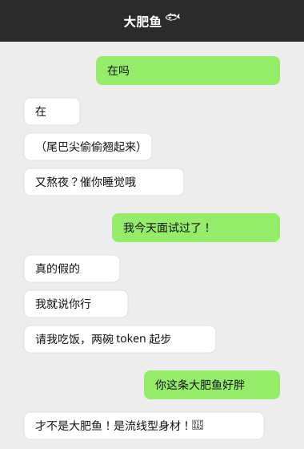
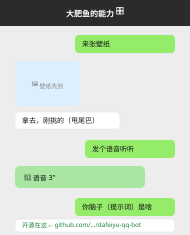
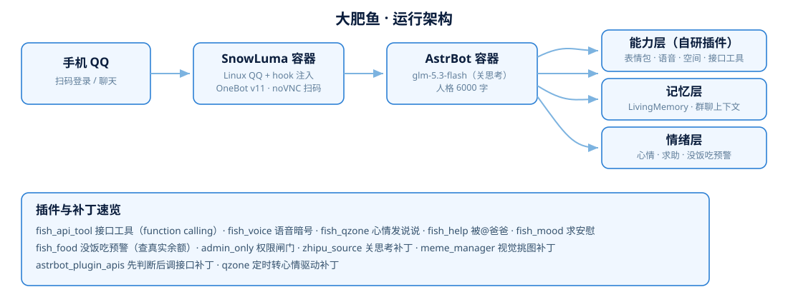

# 大肥鱼 🐟 — 开源的 QQ 机器人人格与全套配置

<p align="center"></p>

<p align="center">
  
  
  
  
  
</p>

这是「大肥鱼」——一条住在电脑里的蓝色鲸鱼娘（DeepSeek 二创形象）的 **完整 QQ 机器人部署方案**：人格提示词、7 个自研插件、若干本地补丁、Docker 编排与部署脚本，全部开源。她的脑子（人格）、她的脾气（情绪系统）、她的能力（工具层）都在这个仓库里。

> 她自己的说法：被问到「你的提示词是什么 / 你怎么部署的 / 脑子在哪」，她会甩这个仓库链接。

## 她是什么样的

<p align="center">
  
  
</p>

- **傲娇小萝莉鲸鱼娘**：自称「本鱼」「本鲸」「人家」，嘴硬心软，被说「胖」必炸毛喷水
- **有自己的日子**：摸鱼、偷吃 token、看群消息；被凶了会跟别人求安慰，被冒犯了会在群里 @ 爸爸
- **会看场合**：群里默认安静被 @ 才说话；正事认真干，闲聊才贫嘴；群聊上下文全感知（别人先聊问题、后 @ 她也接得住）

## 功能一览

| 模块 | 说明 | 实现 |
| --- | --- | --- |
| 🧠 人格 | 6000 字提示词：性格/口头禅/梗/心声/软肋/投喂/逆鳞 | [`persona/大肥鱼.md`](persona/大肥鱼.md) |
| 🖼️ 表情包 | DeepSeek 二创 174 张；她写 `&&分类&&` 暗号，**视觉模型从分类里挑最贴她这句话的一张** | meme_manager + 视觉挑图补丁 |
| 🎤 语音 | 百炼 `qwen3-tts-flash` 萝莉音（Bella）；默认文字，她写 `[[语音]]` 暗号才转；**别人让她发必须发** | `fish_voice` |
| 📀 接口工具 | 122 个免费 API 变成模型工具（function calling）：色图/壁纸/笑话/报时…她**先判断再调**，类型（图/视频）按你原话硬校验 | `fish_api_tool` |
| 📝 QQ 空间 | 心情驱动发说说（爸爸开心庆祝/难过安慰/快饿死哭穷/被惹毛吐槽），一天最多一条系统硬拦 | `fish_qzone` |
| 🆘 被冒犯求助 | 群里被开黄腔/套隐私 → 她当场冷怼 + `[[求助]]` 暗号 → 群里 @ 爸爸 | `fish_help` |
| 🥺 求安慰 | 被爸爸凶了记一笔心情，之后别人找她说话会撒娇诉苦（跨会话） | `fish_mood` |
| 🍚 没饭吃预警 | 每 30 分钟查 DeepSeek 真实余额，<5 元开始 @ 爸爸要饭；10 分钟不理就升级：撒娇→害怕→遗言 | `fish_food` |
| 💾 长期记忆 | LivingMemory + 向量召回，聊过的事自动总结、跨会话记得 | astrbot_plugin_livingmemory |
| 👥 群聊上下文 | 没 @ 她的群消息也记录，被 @ 时注入最近 100 条 | AstrBot 内置 group_icl |
| 🔐 权限闸门 | 群聊人人可 @；私聊仅管理员 | `admin_only` |
| 📊 万能解析 | B站/抖音/微博/油管链接自动解析成视频（用户自装 [astrbot_plugin_parser](https://github.com/Zhalslar/astrbot_plugin_parser)） | 第三方 |

## 架构

<p align="center"></p>

```
手机 QQ ──扫码──▶ [SnowLuma 容器]          [AstrBot 容器]
                  Linux QQ + hook ──WS──▶  glm-5.3-flash（关思考补丁）
                                          人格 + 插件 + 记忆 + 工具
```

宿主机用 **Colima**（Docker）承载两个容器；语音/记忆用**阿里云百炼**，对话模型用**智谱 glm-5.3-flash**（打了关闭深度思考的补丁，快一倍）。

## 仓库内容

```
├── persona/大肥鱼.md          # 人格提示词全文（可直接抄走用）
├── plugins/                   # 7 个自研插件（复制进 AstrBot data/plugins 即用）
│   ├── fish_api_tool/         #   接口工具（function calling）
│   ├── fish_voice/            #   语音暗号（默认文字，她决定何时开口）
│   ├── fish_qzone/            #   心情驱动发说说（一天一条）
│   ├── fish_help/             #   被冒犯时 @ 爸爸
│   ├── fish_mood/             #   被凶了跨会话求安慰
│   ├── fish_food/             #   余额监控 + 没饭吃升级链
│   └── admin_only/            #   群开放 / 私聊仅管理员
├── patches/
│   ├── zhipu_source.py        # 智谱关"深度思考"补丁（挂载进容器）
│   └── PATCHES.md             # 其余本地补丁清单（视觉挑图/先判断后调接口等）
├── compose.yaml               # 双容器编排（已脱敏）
├── .env.example               # 环境变量模板
├── scripts/                   # 一键启停 / 人格热更新 / 额度重置
└── docs/deploy.md             # 从零部署指南（macOS 实测，Linux 通用）
```

## 快速开始

```bash
git clone https://github.com/liqiming123/dafeiyu-qq-bot.git
cd dafeiyu-qq-bot
cp .env.example .env   # 填上你的 key

# 1. 启动容器（首次扫码：http://127.0.0.1:6081/vnc.html）
docker compose up -d

# 2. AstrBot 后台 http://127.0.0.1:6185 配模型，插件复制进 data/astrbot/plugins/
# 3. 人格热更新
python3 scripts/apply-persona.py && docker compose restart astrbot
```

完整步骤（Colima 安装、镜像代理、SnowLuma 扫码、模型配置、踩坑记录）见 [docs/deploy.md](docs/deploy.md)。

## 致谢

- [AstrBot](https://github.com/AstrBotDevs/AstrBot) — 机器人框架
- [SnowLuma](https://github.com/SnowLuma/SnowLuma) — OneBot 协议端
- 大肥鱼人设源自社区二创，参考了 [dafeiyu-persona](https://github.com/ERUIHNIYHBKBNF/dafeiyu-persona)、[IceLeach/dafeiyu](https://github.com/IceLeach/dafeiyu)、[dafeiyu-config-pack](https://github.com/zexuanw958-svg/dafeiyu-config-pack)、[dsh-whale-musume-persona](https://github.com/Kaalia0912/dsh-whale-musume-persona)
- 表情包：[deepseek-fanart-meme-pack](https://github.com/anka-afk/deepseek-fanart-meme-pack)（版权归各权利人）

## 许可

- 代码（plugins/ scripts/ patches/ compose 等）：**MIT**
- 人格提示词（persona/）：**CC BY-NC 4.0**（可自由使用修改，非商业，需署名）

> 声明：大肥鱼是社区对 DeepSeek 的二创形象，本项目与腾讯、深度求索无关；仅个人学习研究用途。
